<div align="center">

# Peak Duo: open-source foldable phone for FiveM

**A full smartphone for ESX, QBCore and Qbox, with a foldable dual-screen handset, Split View multitasking, 35+ apps, real calls and FaceTime-style video calls.**

[](LICENSE)


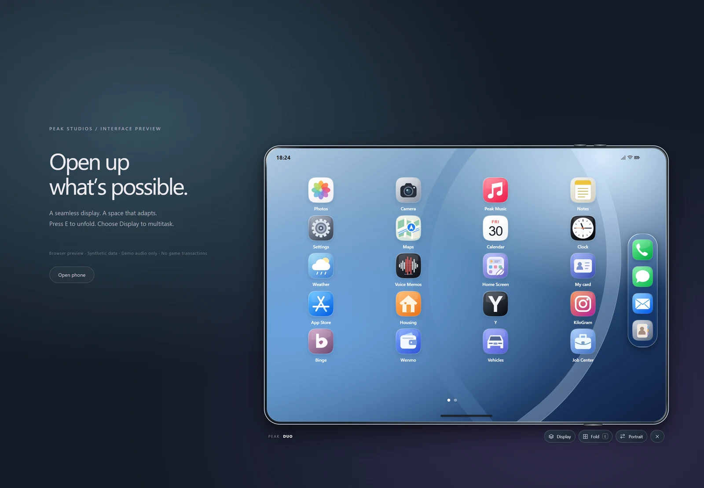

</div>

> [!NOTE]
> **Peak Duo used to be a paid resource and is now free and open source.** It is maintained on a best-effort basis by the community. There is no paid support or guaranteed response time. Issues and pull requests are welcome; see [CONTRIBUTING.md](CONTRIBUTING.md).

---

## Contents

- [Highlights](#highlights)
- [Screenshots](#screenshots)
- [Requirements](#requirements)
- [Quick start](#quick-start)
- [Documentation](#documentation)
- [Try the UI in your browser](#try-the-ui-in-your-browser)
- [Development](#development)
- [Support and maintenance](#support-and-maintenance)
- [License](#license)

## Highlights

- **A foldable handset.** Press <kbd>E</kbd> to unfold the cover screen into a wide inner display. The custom 3D prop folds in the player's hand, with fold and SIM-tray animations for male and female freemode peds.
- **Split View and multitasking.** Run two apps side by side, resize the split, swap panes, use the App Switcher, and switch between portrait and landscape.
- **iOS-style design.** Light and dark appearance, a Control Center, lock screen with PIN, notifications, a Home Screen editor with pages and a dock, wallpapers and ringtones.
- **Real communication.** Server-authoritative voice calls through `pma-voice`, and FaceTime-style video calls that stream the *game camera* over WebRTC with a TURN relay (Cloudflare or self-hosted coturn).
- **Messages and social.** Direct and group chats with voice notes, reactions and images, plus Mail, Contacts, **Y** (an X-style feed), **KiloGram** (photos, stories, live streams and gifts) and **Binge**.
- **Everyday apps.** Maps with a GTA V atlas and Find My, Weather, Clock (alarms, timers, world clock), Notes, Calendar, Calculator, Voice Memos, Photos and Camera, and Peak Music (free Audius catalog).
- **Economy and city life.** Wenmo bank transfers with an idempotent operation journal, fictional crypto, Yellow Pages, Services directory, News, DOJ, Vehicles, and a **Job Center with a Job Creator** for building group contracts in-game.
- **Physical devices and SIM cards.** Unique phone items with PIN lock, owned SIM cards you can insert, swap and remove (with animations), phone breaking, and multiple numbers per character.
- **Secure by default.** Every action is validated on the server. Secrets stay in server-only convars. NUI input is sanitized, request sizes are capped, and expensive actions have cooldowns.
- **Owner-configurable.** Rename apps, change icons, set a default Home layout, limit apps to certain jobs, and set your own Maps places, news branding and App Store text, all from `sv_config.lua`.

## Screenshots

<table>
<tr>
<td align="center">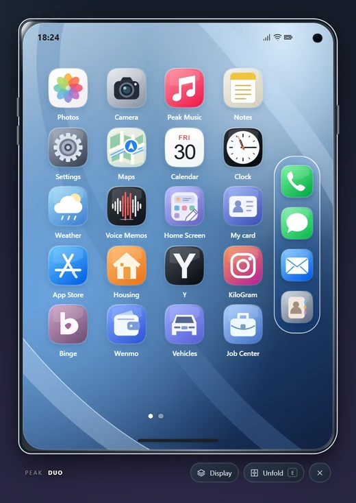<br><sub>Home (folded)</sub></td>
<td align="center">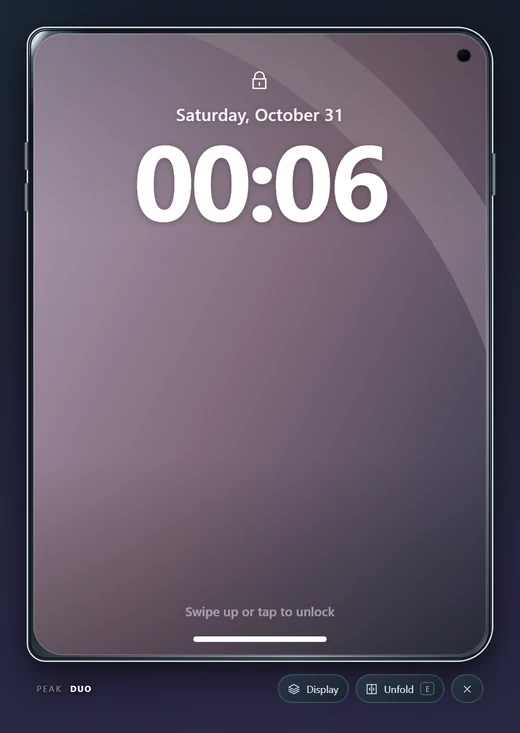<br><sub>Lock screen</sub></td>
<td align="center">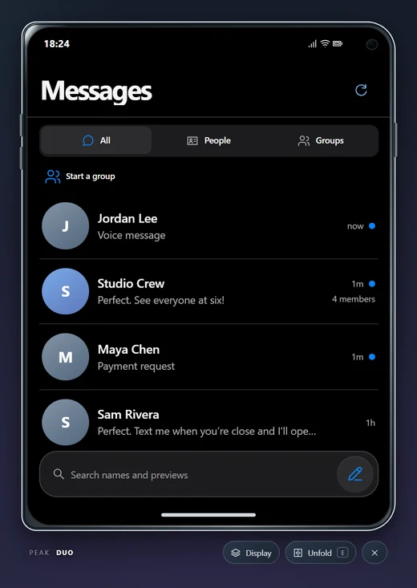<br><sub>Messages</sub></td>
<td align="center">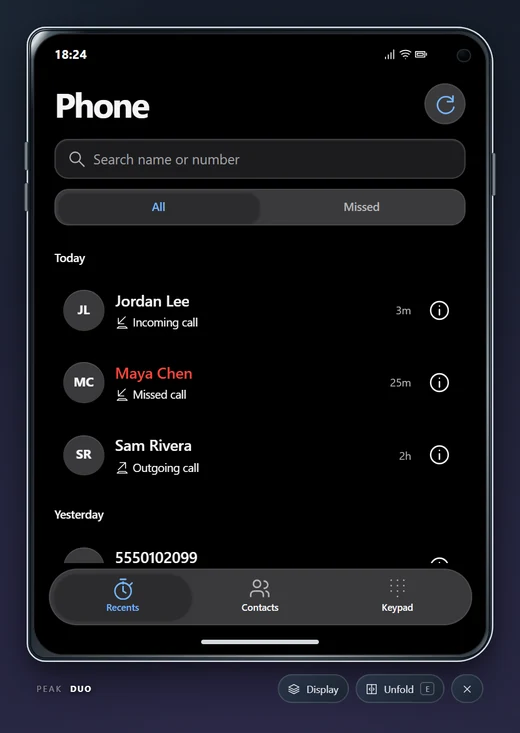<br><sub>Phone</sub></td>
</tr>
<tr>
<td align="center">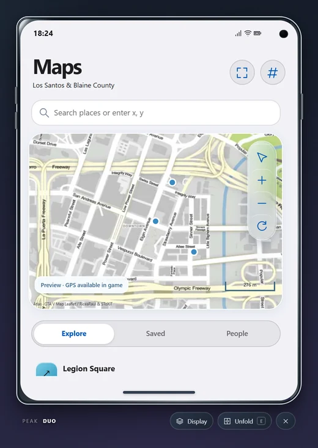<br><sub>Maps</sub></td>
<td align="center">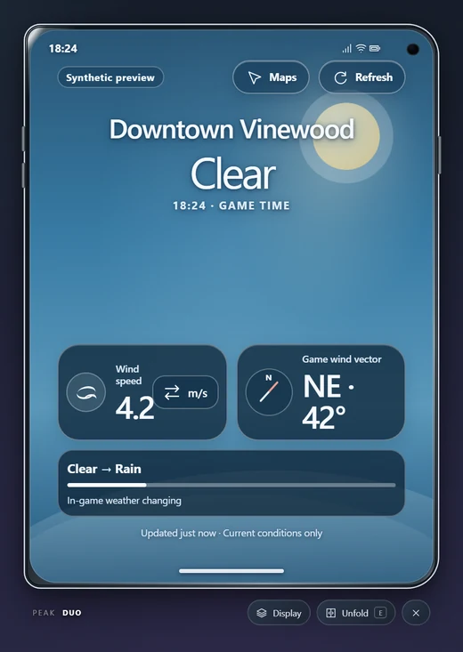<br><sub>Weather</sub></td>
<td align="center">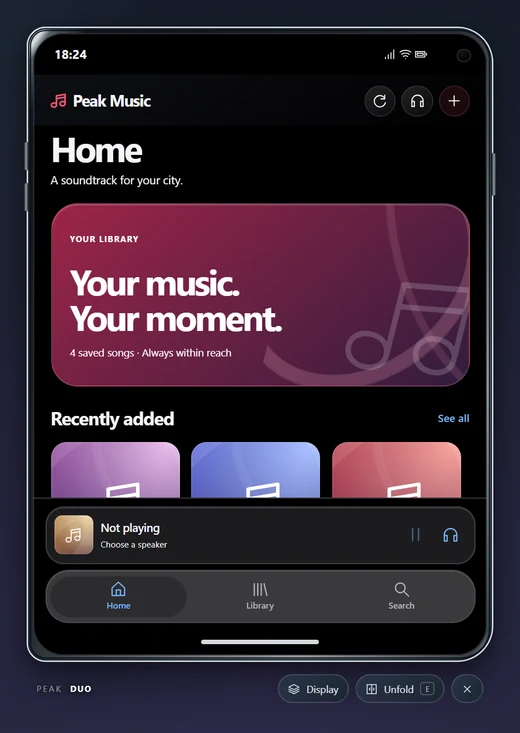<br><sub>Peak Music</sub></td>
<td align="center">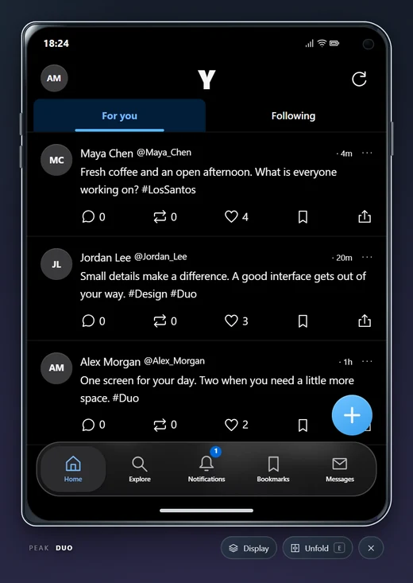<br><sub>Y</sub></td>
</tr>
<tr>
<td align="center">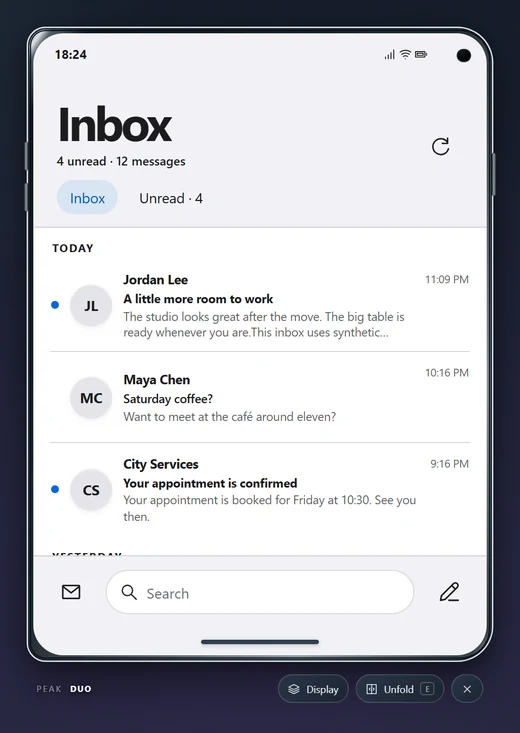<br><sub>Mail</sub></td>
<td align="center">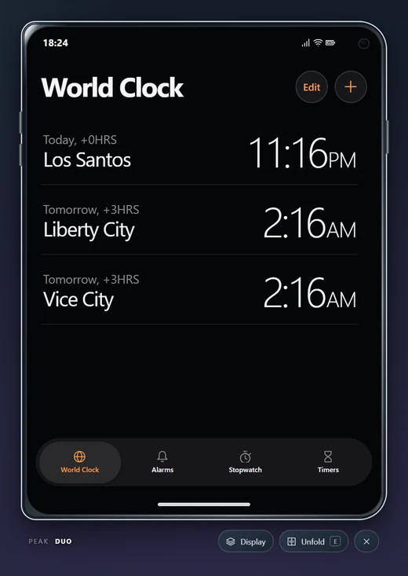<br><sub>Clock</sub></td>
<td align="center">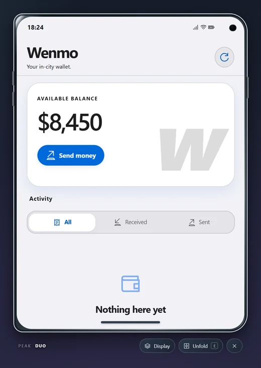<br><sub>Wenmo</sub></td>
<td align="center">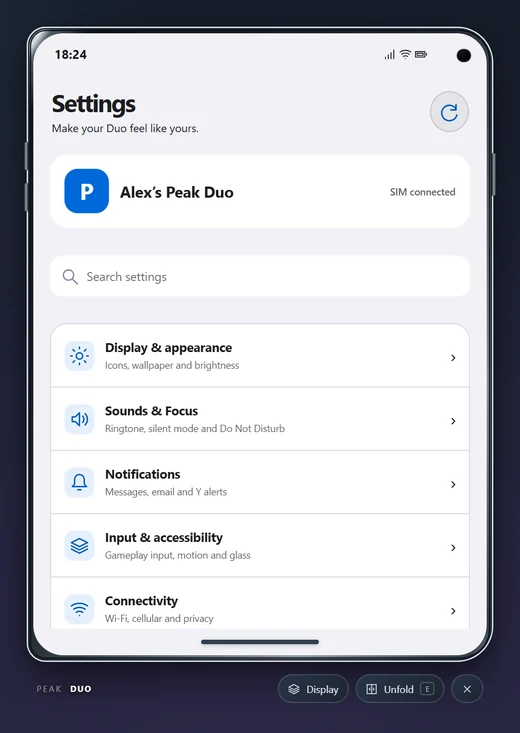<br><sub>Settings</sub></td>
</tr>
<tr>
<td align="center">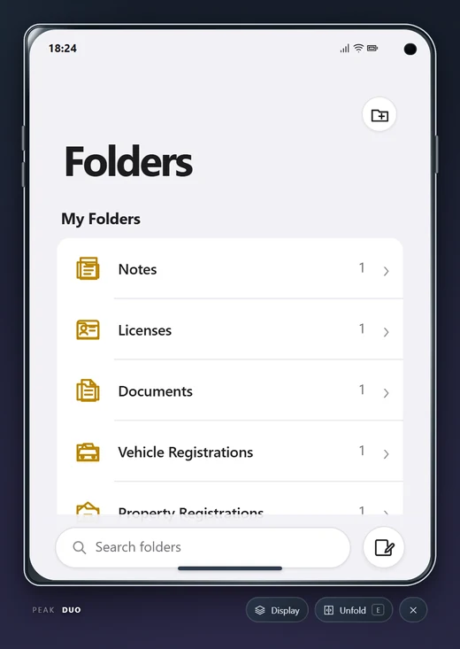<br><sub>Notes</sub></td>
<td align="center">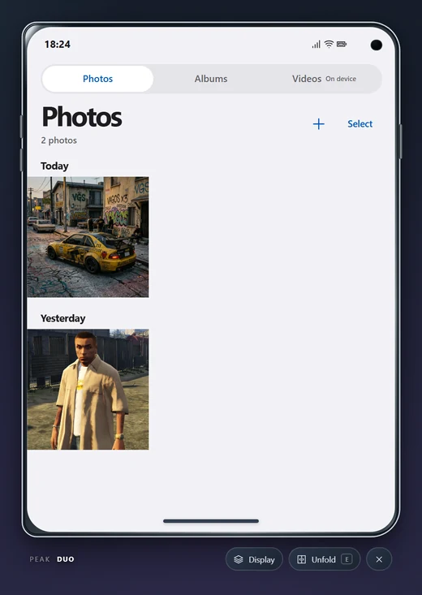<br><sub>Photos</sub></td>
<td align="center">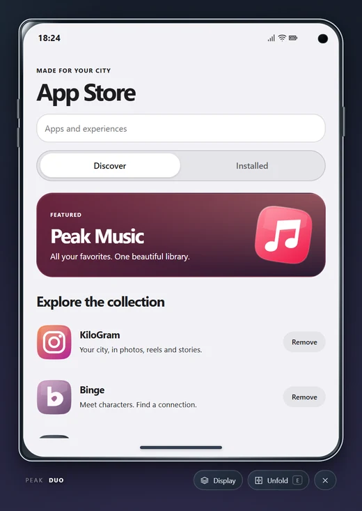<br><sub>App Store</sub></td>
<td align="center">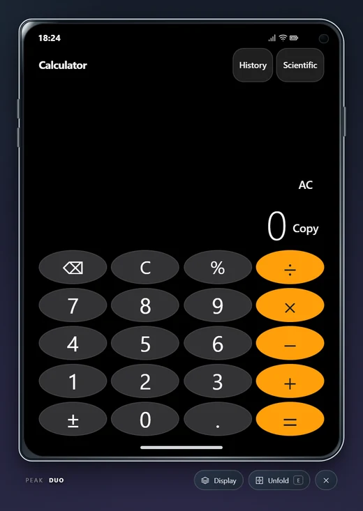<br><sub>Calculator</sub></td>
</tr>
</table>

**Split View.** Two apps side by side on the unfolded display:

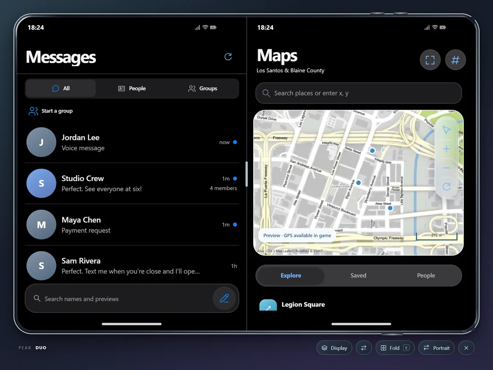

**The 3D handset**, included as the `peak-duo-prop` resource:

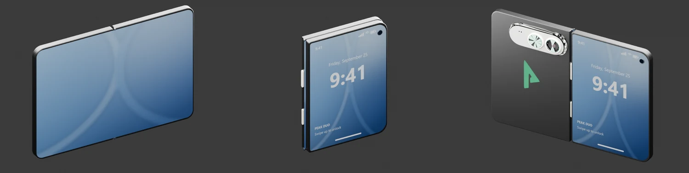

> These screenshots come from the built-in browser preview, which uses synthetic data. In game, the phone shows your server's real data.

## Requirements

| Dependency | Required | Notes |
|---|---|---|
| FiveM server with **OneSync** | Yes | |
| [`ox_lib`](https://github.com/overextended/ox_lib) | Yes | |
| [`oxmysql`](https://github.com/overextended/oxmysql) | Yes | MySQL 8 or MariaDB 10.6+ recommended |
| [`peak-bridge`](https://github.com/Peak-Studios/peak-bridge) | Yes | Framework, inventory and banking bridge (MIT) |
| One framework | Yes | `qb-core`, `qbx_core` or `es_extended` (ESX Legacy) |
| An inventory with a `phone` item | Yes | Metadata support (ox_inventory, qb-inventory and similar) is needed for unique phones and SIMs |
| [`pma-voice`](https://github.com/AvarianKnight/pma-voice) | For calls | Voice calls and FaceTime audio |
| A TURN service | For video calls | Cloudflare Realtime TURN or your own coturn |
| `screenshot-basic` + a [FiveManage](https://fivemanage.com) API key | For camera uploads | Optional |
| `xsound` | For in-world music | Optional |

The bundled `peak-duo-prop` and `peak-sim-assets` resources (in [`extras/`](extras/)) are required.

## Quick start

1. **Back up your database.** On first start the phone creates its own tables (`PhoneConfig.AutoMigrate = true`).
2. Download the [latest release](https://github.com/Peak-Studios/peak-phone/releases) or clone the repository. Put these three folders in your `resources` directory:
   - `peak-phone`: this repository. **The folder must be named `peak-phone`.**
   - `peak-duo-prop`: copied from `extras/peak-duo-prop`
   - `peak-sim-assets`: copied from `extras/peak-sim-assets`
3. Install [`peak-bridge`](https://github.com/Peak-Studios/peak-bridge) and add the `phone` (and optionally `simcard`) items to your inventory. Ready-made definitions are in [`config-examples/`](config-examples/).
4. Add this to `server.cfg` **after** your framework and inventory:

   ```cfg
   ensure ox_lib
   ensure oxmysql
   ensure peak-bridge
   ensure pma-voice
   ensure peak-duo-prop
   ensure peak-sim-assets
   ensure peak-phone
   ```

5. Start the server and run `phone_doctor` in the **server console**. It reports any missing dependency or configuration.
6. Give yourself a `phone` item. Open the phone with <kbd>M</kbd> or `/phone`, and fold or unfold it with <kbd>E</kbd>.

The full guide is in [docs/installation.md](docs/installation.md). Video calls need a TURN service; see [docs/video-calls.md](docs/video-calls.md).

> The UI ships prebuilt. **You don't need Node.js or npm to run the resource.**

## Documentation

| Guide | What it covers |
|---|---|
| [Installation](docs/installation.md) | Step-by-step setup, inventory items, start order, upgrading from `fw-phone` |
| [Configuration](docs/configuration.md) | `shared/settings.lua`, `sv_config.lua`, app branding, job access, permissions, commands |
| [Features](docs/features.md) | Every app, what it needs, and its limits |
| [Video calls](docs/video-calls.md) | Cloudflare TURN and coturn setup, and how video works |
| [Database](docs/database.md) | Tables, automatic migration, manual import and rollback |
| [Integrations and API](docs/integrations.md) | Exports, adapters for garages/news/custom apps, and the SIM API |
| [Troubleshooting](docs/troubleshooting.md) | Common problems and fixes |
| [Development](docs/development.md) | Project layout, building, tests and the browser preview |

## Try the UI in your browser

You can explore the interface without a FiveM server:

```sh
git clone https://github.com/Peak-Studios/peak-phone.git
cd peak-phone
npm run preview      # then open http://127.0.0.1:8791
```

The preview needs only Node.js 18+, with no `npm install`. It uses synthetic data, so apps that need the live server show a "needs the live FiveM server" message.

## Development

```sh
npm run build        # rebuild the compatibility app bundle
npm test             # Node contract and unit tests
npm run test:lua     # Lua logic against mocked FiveM natives (Python 3 + Lua 5.4 lib or `pip install lupa`)
npm run verify       # check runtime files against the integrity manifest
```

See [docs/development.md](docs/development.md) for the architecture, browser tests and how to add an app.

## Support and maintenance

Peak Duo is released **as-is** by Peak Studios. The original author can't provide 24/7 support, so:

- **Bugs and feature requests:** open a [GitHub issue](https://github.com/Peak-Studios/peak-phone/issues) using the templates. Include your framework, inventory, server artifact and `phone_doctor` output.
- **Fixes and improvements:** pull requests are very welcome.
- **Security problems:** please report them privately; see [SECURITY.md](SECURITY.md).

Every server stack is different. Test on a staging server with your own framework, inventory and database before going live.

## License

Peak Duo is free software released under the **[GNU General Public License v3.0](LICENSE)**. You can use it on your server, change it and share it. If you distribute a modified version, you must release it under GPL-3.0 with its source code. **Reselling this resource as closed source is not allowed.**

Third-party components and assets keep their own licenses; see [THIRD_PARTY_NOTICES.md](THIRD_PARTY_NOTICES.md).

Peak Duo is a fan-made roleplay resource. It is not affiliated with or endorsed by Apple, Rockstar Games, Take-Two Interactive, Cfx.re or any brand its parody apps reference. *iOS* and *FaceTime* are trademarks of Apple Inc. and are used only to describe the design style.
